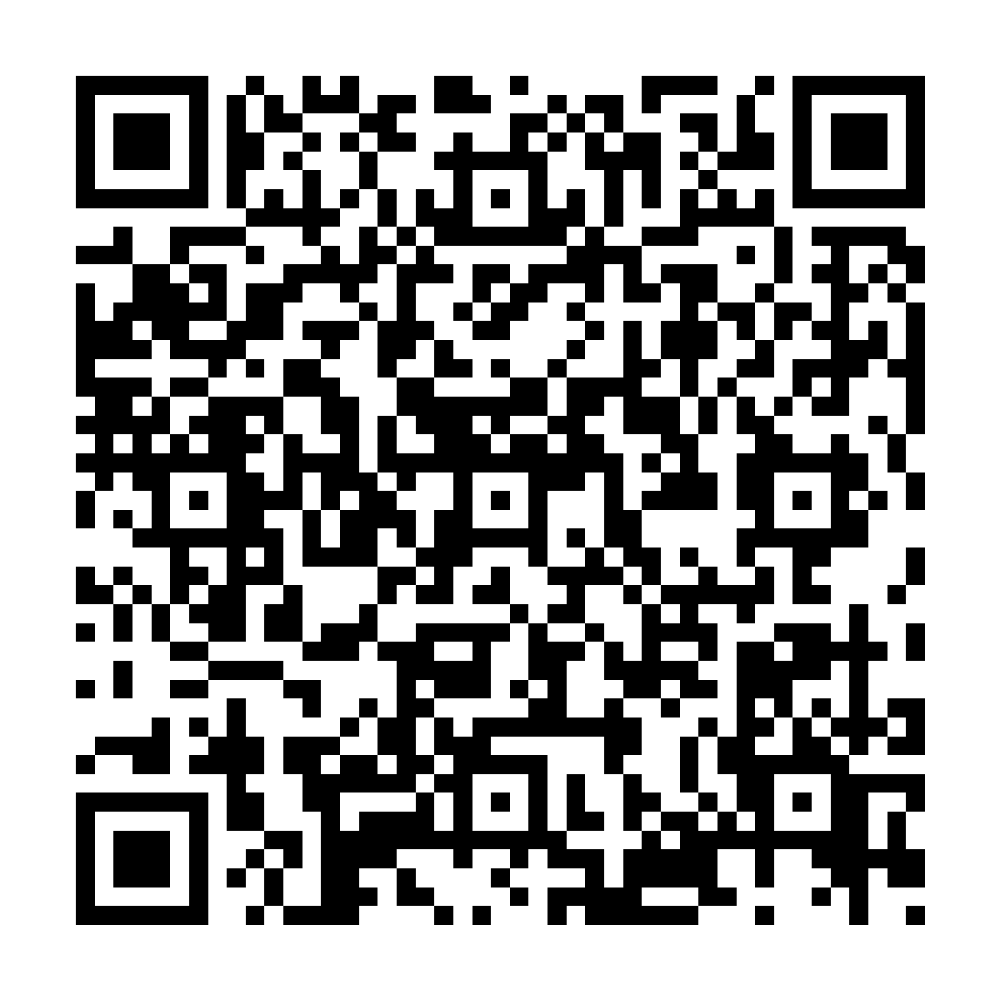

<!-- presentation -->
# Indulás: AI Sales & Marketing Workshop

[cspiya.github.io/wenova-ai-sales-workshop/materials/](https://cspiya.github.io/wenova-ai-sales-workshop/materials/)

1. Hozz létre egy `Wenova-AI-Sales-Workshop` mappát, és nyiss rá Cowork-projektet.
2. Másold be a Claude-ba a telepítő mondatot a kezdőlapról.
3. Kövesd a Claude lépéseit, majd írd be: **Kezdjük a felkészülést.**
